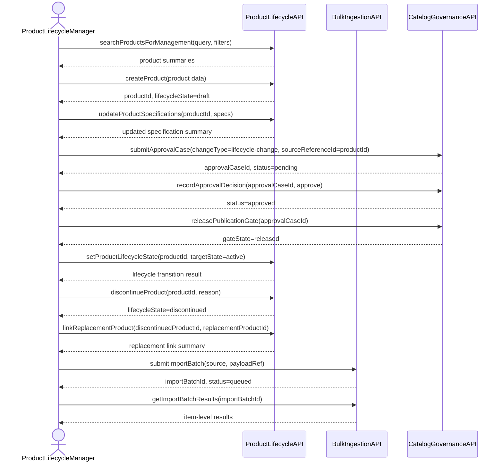
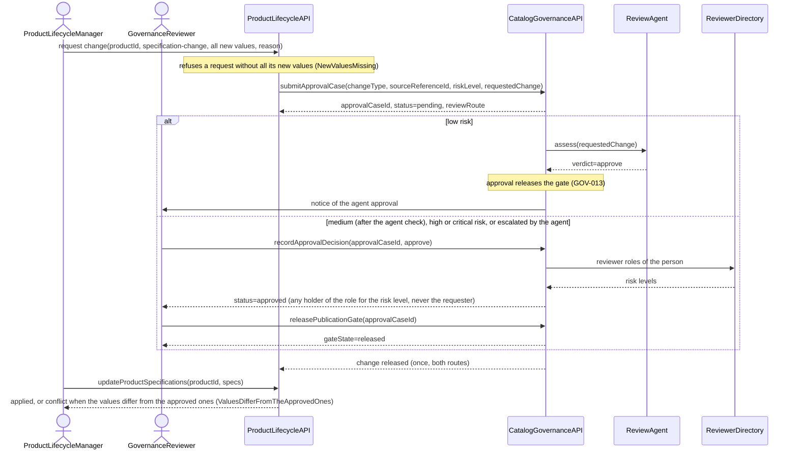
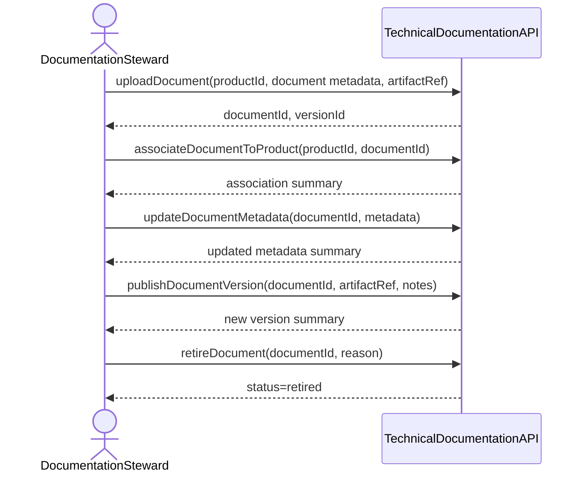
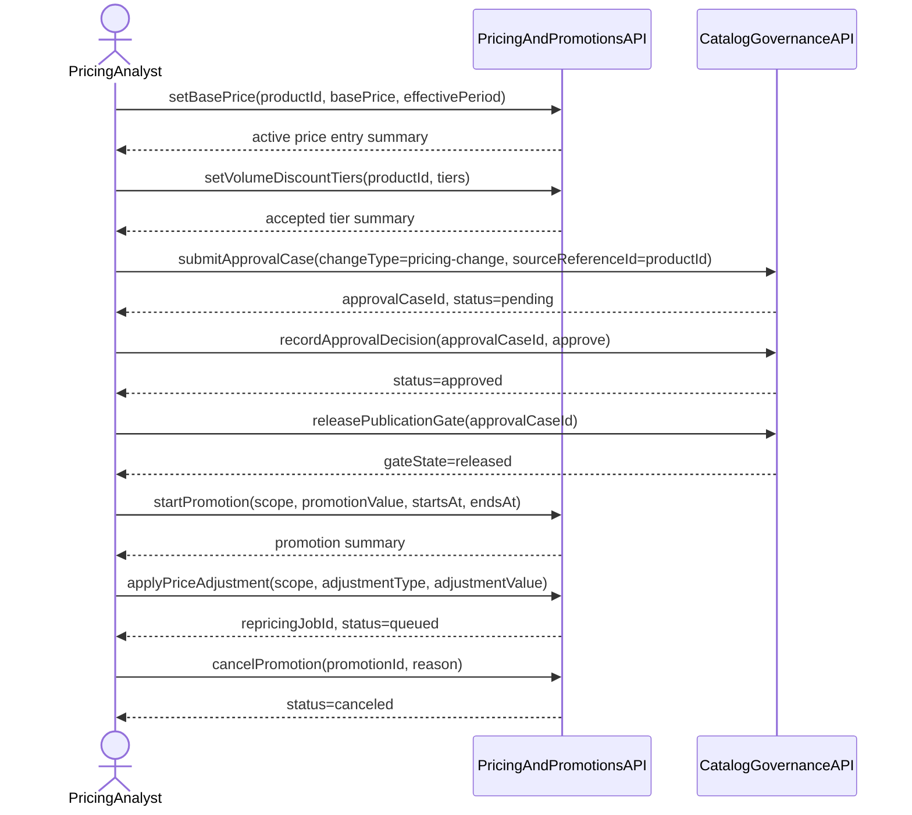
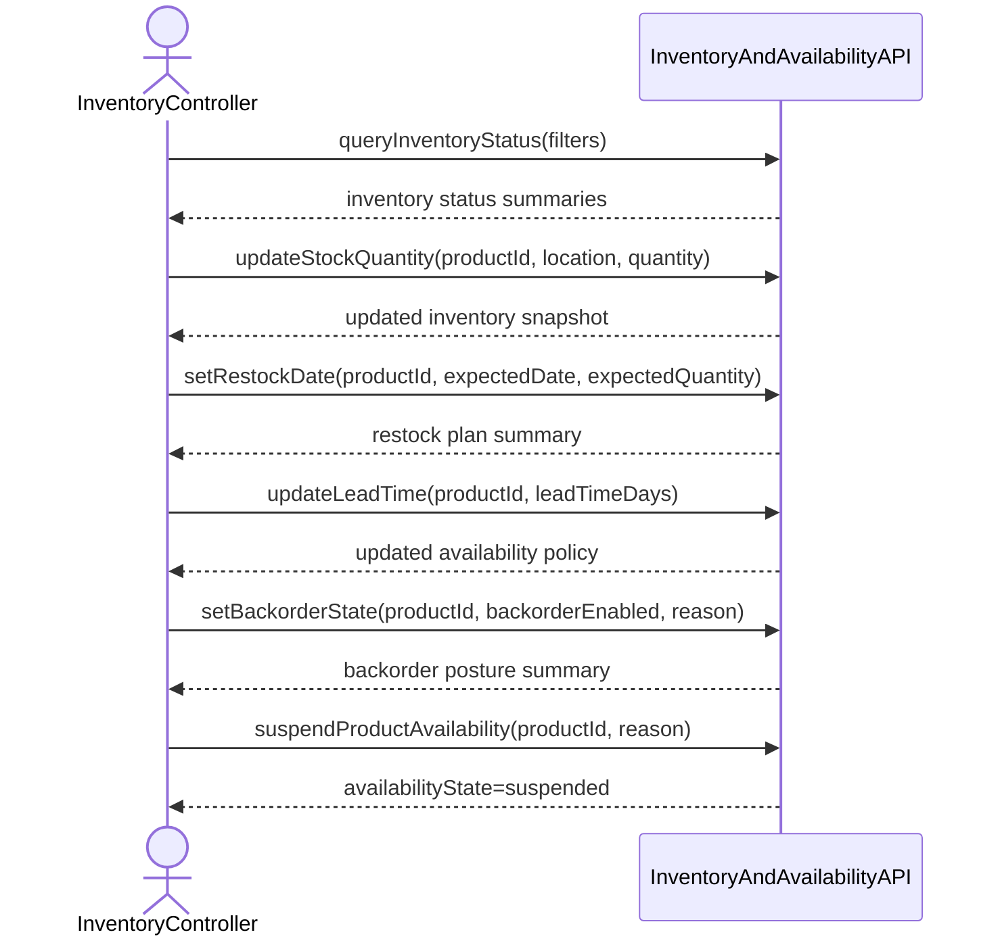
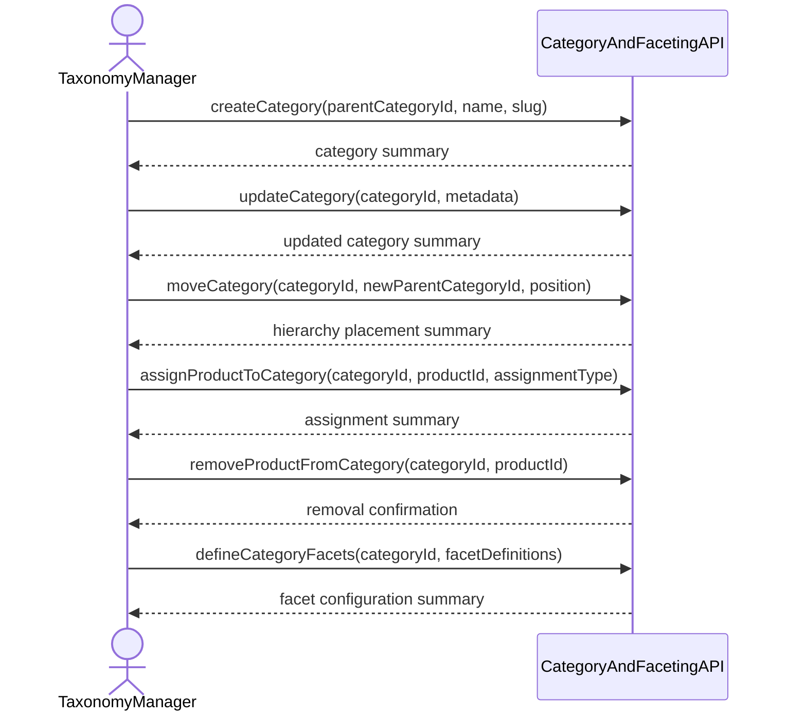
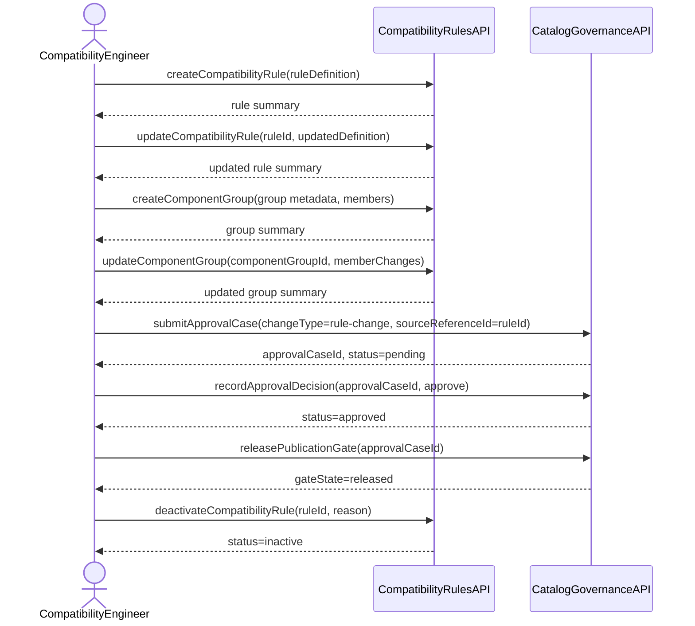

# Catalog Management v2 — Sequence Diagrams

> **Phase:** ADDR — Define
> **Status:** Draft

---

## JS1: Product Lifecycle Management

### JS1: Reviewed change with typed values (drone-web D-039)

A change on an active product carries its new values as typed fields. Governance approves the text
made from them, and Product Data applies only those values after the release. The JS1 event model
(`../../eventmodel/`) holds the rules: PLC-012 (typed values), GOV-012 (decide by reviewer role) and
GOV-013 (an agent approval releases the gate). The operation that requests a specification or details
change on an active product is open (200 or 202 is still to be decided).

## JS2: Technical Documentation Management

## JS3: Pricing and Promotions Management

## JS4: Inventory and Availability Management

## JS5: Category and Faceting Management

## JS6: Compatibility Rules Management

