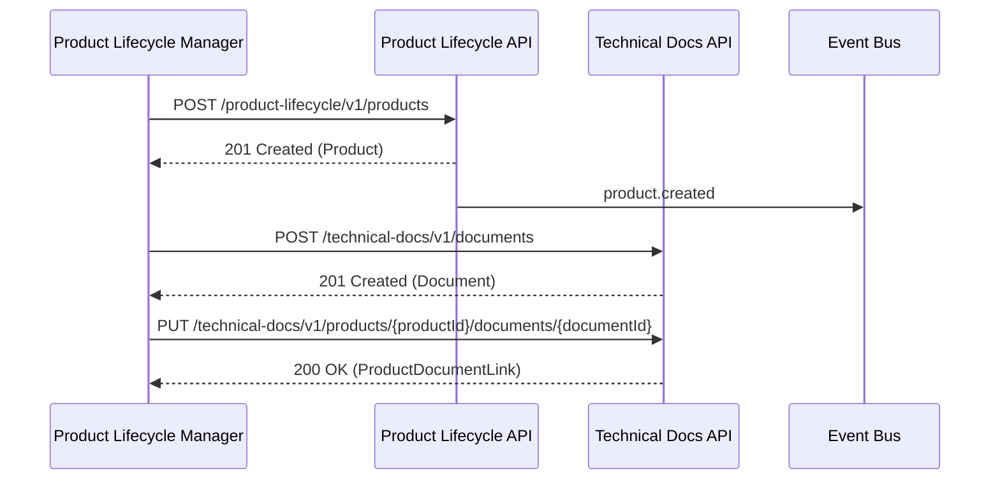
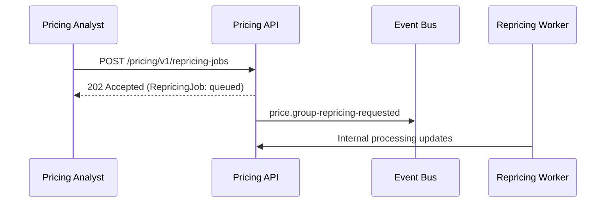
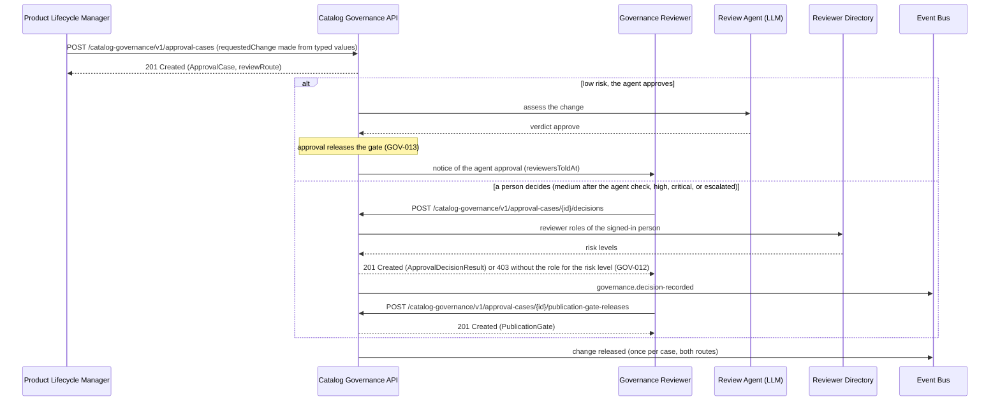
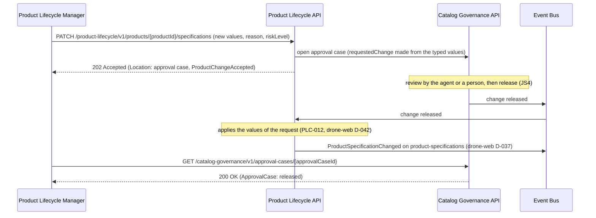
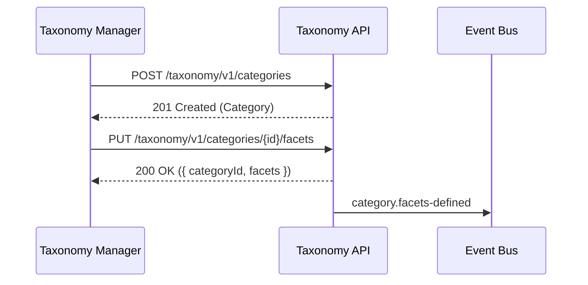
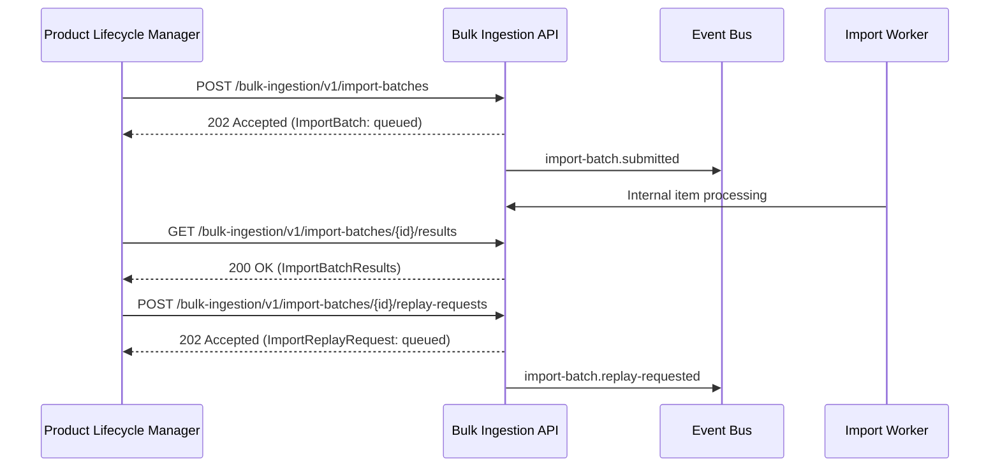

# Catalog Management v2 — Sequence Diagrams

## JS1/JS2: Create Product and Attach Documentation

## JS3: Repricing Flow (Async)

## JS4: Approval Case and Publication Gate

Any person who holds the reviewer role for the case's risk level may decide, not only the assigned
reviewer; the person who asked never decides. The release message is `ChangeReleased` in the JS1
event model (`../../eventmodel/`); this file has no published contract for it yet (drone-web D-039).

## JS1: Change an Active Product (202 Accepted, Applied on Release)

The manager sends the new values once. After the release Product Data applies them itself; there
is no second call (drone-web D-042). `PATCH /product-lifecycle/v1/products/{productId}` works in the
same way for the name and short description, and the new name then reaches `product-records`. A
lifecycle change (`POST .../lifecycle-transitions`, also `202 Accepted` with `Location`) takes
effect through `POST .../publications` or `POST .../discontinuations` after the release.

## JS5: Taxonomy and Facet Management

## JS6: Bulk Ingestion and Replay

