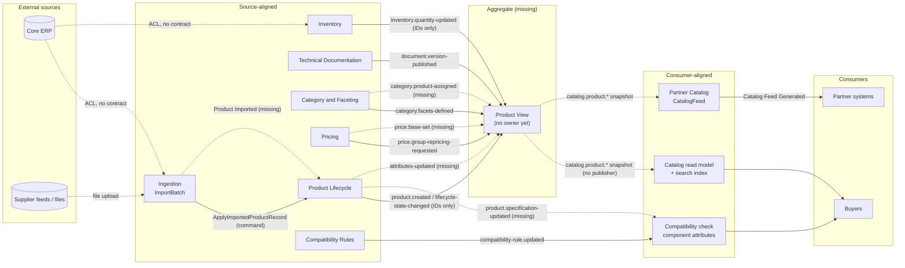

# drone-web product data as a data mesh: data products and lineage

Research, 2026-10-25. This file reframed the then-open decision on drone-web's product event contracts (options A, B and C, whose drafts are in this folder) as a data mesh question: who produces which product data, who puts it together and republishes it, and whether each consumer reads source-aligned or consumer-aligned data. All drone-web paths are relative to the repo root of `github.com/cjjohansen/drone-web` (main, commit `685ca5f`); line numbers refer to that commit.

> **Status: closed.** The analysis led to option D (section 5), which was chosen as D-037 "Product event contracts: source-aligned fact streams" in [`.ralph/agent/decisions.md`](../../../.ralph/agent/decisions.md). The published contracts are in [`design/contracts/`](../README.md). The channels there have different names from the ones this file uses: for example `product.specification-updated` is now `product-specifications`, `price.base-set` is now `effective-prices`, `product.imported` is now `product-imports`, and the identifier-only `inventory.quantity-updated` is superseded by `product-availabilities`. In the terms used there, the owners' streams are **published streams** carrying **published events**, the events inside a context's own event store are **internal events**, and the ERP and supplier files are **upstream**. The names below are kept as they were when this was written.

## 1. The three kinds of data product

Zhamak Dehghani, *Data Mesh* (O'Reilly 2022), chapter 4 "Principle of Domain Ownership", section "Domain Data Archetypes". The wording below is paraphrased from memory, so check it against the book before quoting it:

- **Source-aligned domain data**: data that reflects the business facts produced by an operational system. She also calls it a "native" data product.
- **Aggregate domain data**: data that combines several upstream domains.
- **Consumer-aligned domain data**: data reshaped to fit one or more specific uses. She also calls it "fit-for-purpose" data.

The 2019 article that came first ("How to Move Beyond a Monolithic Data Lake to a Distributed Data Mesh", martinfowler.com) used only two groups: "source oriented domain data" and "consumer oriented and shared domain data".

Adam Bellemare, *Building an Event-Driven Data Mesh* (O'Reilly 2023), chapter 2, uses the same three kinds for event streams, with two differences. His "aggregate" means sums against business criteria (hourly sales per store), not joins across domains. He also says a consumer-aligned product "may combine source and aggregate data products" and should be used sparingly. The difference matters for drone-web: a Product View that joins Product, Price and Stock is an aggregate in Dehghani's sense and consumer-aligned in Bellemare's. Below, **aggregate** means Dehghani's join across domains.

Dehghani wrote her archetypes for analytical data. drone-web's streams are operational read models. Bellemare's book is the bridge, because it treats one event stream as serving both uses.

## 2. Contexts and their data products

Confidence: **H** means stated in the repo, **M** means inferred from several files, **L** means guessed or contradicted.

| Context / system | Product facts it owns or produces | Inputs (lineage) | Kind | Evidence | Conf. |
| --- | --- | --- | --- | --- | --- |
| **Core ERP** (external) | Product records, stock, lead times "at creation" | Manual entry | Upstream system; not a designed data product | `design/strategy/architecture-for-flow/subdomains-and-contexts.md:87,101-102,120-121`; `Specs/Case/JTBD/personas/all-personas.md:503,584` | M |
| **Flight Data Hub / Channel Syndication Platform / Analytics Warehouse** (the case company's as-is systems) | Translated product attributes, channel exports, industry taxonomy files | Core ERP via a "translation layer" | Upstream; outside drone-web's design | `all-personas.md:31,144,259` | L (case material only, never mapped to drone-web contexts) |
| **Supplier feeds / structured files** | Product records, spec sheets, lead times | External | Upstream; source for Ingestion | `design/catalog-management/addr/align/activity-steps.md:13`; `.../personas.md:15,39` | M |
| **Ingestion** (Bulk Ingestion) | ImportBatch, item results, replay | `sourceSystem` + file reference | Not a product data product; a pipeline that dispatches commands into Product Lifecycle | `design/catalog-management-v2/addr/align/boundary-map.md:16,29`; `.../refine/bulk-ingestion-api.yaml:118-120`; `subdomains-and-contexts.md:100,118-119` | H |
| **Product Lifecycle** (Product Data) | Product identity, sku, name, brand, attributes, specifications, lifecycle state, replacement link | Staff edits + `ApplyImportedProductRecord` from Ingestion | **Source-aligned** (curated master data) | `boundary-map.md:9,33`; `engineering-strategy/strategy.md:68` | H for ownership; M for "source", because the facts often start in the ERP or supplier files |
| **Technical Documentation** | Document, version, product link | Staff uploads | Source-aligned | `boundary-map.md:10,34,45` | H |
| **Category and Faceting** | Category tree, facets, product-to-category assignment | Product events (`ProductDiscontinued`) | Source-aligned (assignment is its fact, not Product's) | `boundary-map.md:13,24,46` | H |
| **Pricing** | PriceBookEntry: base price, tiers, promotions | Product events (`ProductActivated`); Governance decisions | Source-aligned | `boundary-map.md:11,22,35` | H |
| **Inventory** | InventoryPosition: on hand, lead time, backorder, suspension | ERP/warehouse (ACL); `ProductCreated` | Source-aligned, though counts start in the ERP | `boundary-map.md:12,23,36`; `strategy.md:39`; `subdomains-and-contexts.md:24` | M |
| **Compatibility Rules** | Rules, component groups | Product specs (`ProductSpecificationUpdated`) | Source-aligned (rules); not product facts | `boundary-map.md:14,25,38` | H |
| **Governance** | ApprovalCase, decision, publish gate | Change requests from Pricing, Rules, Product | Not a product data product; it gates when facts become visible | `boundary-map.md:15,27-28,39`; v2 `integration-events.yaml:50-54` | H |
| **Catalog** (Catalog API, includes search) | Reviews; the joined product read model; storefront `catalog.product.*` | Today it claims to publish them itself (`source: catalog-api`); per P2 it should be fed from the write side | **Consumer-aligned** (product read model); **source-aligned** for Reviews | storefront `define/boundaries.md:17,29-32,38,117`; storefront `refine/integration-events.yaml:143,329,359`; `strategy.md:70` | M; the repo contradicts itself (boundaries.md says it "owns product data", strategy.md says it owns none) |
| **Search index** | Index documents | Catalog | Consumer-aligned store inside Catalog (bought); not its own product | storefront `align/event-storming.md:82-85`; `team-design.md:27` | M |
| **Compatibility check** | Component attributes (voltage, current, mounting, protocol) | Product specs via ACL + rules (same context) | Consumer-aligned (its own local copy) | storefront `boundaries.md:118,129`; `subdomains-and-contexts.md:94,113-114` | H |
| **Partner Catalog** | CatalogFeed: simplified product, batch price, batch availability | Product, price and availability events via ACL | **Consumer-aligned**, and an outbound data product to partners | storefront `boundaries.md:62-80,119,121`; `strategy.md:88-90` | H |

**Where drone-web is silent or unclear**

1. **Real source vs. curated owner.** The storefront Event Storming leaves this open as a hotspot: "Who is the source of truth for product data? Internal catalog admin? Supplier feeds?" (`design/catalog-storefront/addr/align/event-storming.md:341`). The strategy answers "Product Lifecycle is the only writer of product facts" (`strategy.md:68`), but the ERP and supplier files are where the data starts. In mesh terms, Product Lifecycle is a source-aligned product over *curated* data. The external systems are the true sources, and nothing records which fields came from them.
2. **`strategy.md` contradicts itself.** Line 68 says Product Lifecycle is the only writer. Line 69 says each fact has its own producer (Pricing, Inventory, Documentation). Line 69 is the mesh reading.
3. **Ingestion's output is unclear.** `eventmodel-mapping.md:19` names a `Product Imported` event, but neither the v2 event model nor the AsyncAPI file has it. Only `import-batch.submitted` and `.replay-requested` exist. So no event says "this product version came from batch X, source system Y".
4. **The JTBD systems are not mapped.** Flight Data Hub and Channel Syndication Platform look like a PIM and a syndication tool. drone-web never says whether Product Lifecycle replaces them or whether Partner Catalog replaces the syndication tool.
5. **Lineage is the users' top need.** "Data transparency / lineage visualization" is rated Critical by every persona (`Specs/Case/JTBD/personas/cross-persona-summary.md:37`), but no contract carries lineage.

## 3. Lineage diagram

Solid lines are designed contracts. Dashed lines are flows the repo implies but no contract carries.

## 4. Pivotal events on these boundaries

drone-web has two Event Storming canvases, each labelled "Big Picture" but each scoped to one subdomain. It has no domain-wide big-picture storm. `design/catalog-storefront/addr/align/big-picture-event-storming.drawio` is an unfilled template (placeholders "Subdomain1-3", "PivotalEvent", plus `ProductCreated`, `ProductPublished`, `CategoryAdded To Product`). The v2 run skipped Event Storming (`boundary-map.md:3,53`).

| Pivotal event | Boundary it sits on | Source |
| --- | --- | --- |
| Product Created | Product Lifecycle → Pricing, Inventory, Category, Docs, Rules, storefront, partners ("genesis event, massive fanout") | `design/catalog-management/addr/align/event-storming.md:36,242` |
| Product Discontinued | Product Lifecycle → all three read contexts | management `event-storming.md:61,243`; storefront `event-storming.md:290` |
| Import Batch Processed | **Ingestion → Product Lifecycle**: the external-to-curated line | management `event-storming.md:79,244` |
| Product Added to Catalog | Write side → storefront ("entry point for the entire storefront") | storefront `event-storming.md:47,289` |
| Catalog Feed Generated | drone-web → partners ("data leaves our control") | storefront `event-storming.md:292` |
| Compatibility Check Completed | Inside Compatibility; not a product data boundary | storefront `event-storming.md:291` |

Two things stand out. Import Batch Processed was pivotal in v1 but has no v2 event, so the external-to-curated line has no published contract. The v1 management storm also already listed per-owner integration events (the older drone-web term for published events: Base Price Set, Stock Level Updated, Product Categorized and others) as fact or delta events (`management event-storming.md:263-291`). v2 kept those names in its event model (`design/catalog-management-v2/eventmodel/config.json`) but published only ten of them, all with IDs only.

## 5. Options A, B and C through this lens

| | Source-aligned products | Aggregate / consumer-aligned | Lineage |
| --- | --- | --- | --- |
| **A: full snapshots from Product Lifecycle** | Product Lifecycle republishes Pricing's and Inventory's data under its own name (`source: product-lifecycle`) | None; the source product is also the aggregate | One `productVersion`; it hides which owner changed what (`changedSections` partly helps) |
| **B: thin events + query API** | Each owner emits a change notice (`product.changed`, `price.changed`, `availability.changed`) and serves state by pull | Every consumer builds its own join by calling back | Per-resource `version` + `href`; no record of what was joined |
| **C: owner events + Product View assembler** | Each owner emits a fact event with `sourceVersion` | One `storefront.product-view.updated` aggregate for all consumers | `sourceVersions` map per view (`option-c.yaml:75-77`) |

**A breaks domain ownership.** Price and stock become Product Lifecycle's output, so Pricing and Inventory are no longer source-aligned products anyone can consume. Every price tick also churns the product stream. It does fit `strategy.md:68`, read literally.

**B gives source-aligned products, but only half of them.** The events carry IDs, so the state lives behind pull APIs. That breaks P3's "no synchronous calls" (`strategy.md:76`) and pushes the join into every consumer. Bellemare's "like begets like" applies: pull leads to more pull.

**C is closest to a mesh,** but it treats the joined Product View as the right product for every consumer. The consumers do not need the same thing:

- **Catalog API** needs the full join: identity, specs, categories, docs, price, availability. It should read the aggregate.
- **Compatibility check** needs specifications and lifecycle state only. Price and stock churn would be noise. It should read Product Lifecycle's source-aligned spec stream directly and map it through its own ACL (`subdomains-and-contexts.md:94`).
- **Partner Catalog** needs a simplified product plus batch price and availability (`storefront boundaries.md:79-80`). It could read the aggregate, or read the source streams and keep its own join. Its owner, the Commercial team, also owns Pricing and Inventory (`team-design.md:28`).
- **Search** is inside Catalog and reads Catalog's model. It needs no contract of its own.

**What the lens suggests (option D, the one that was chosen):**

1. **Source-aligned fact streams, one per owner, each owned by its team:** `product.*` (Product Lifecycle: identity, attributes, specs, lifecycle), `category.*` (including product assignment), `document.*`, `price.*`, `inventory.*`. These are state (fact) events, keyed by `productId`, with a per-owner `sourceVersion`, as v1 already sketched.
2. **Zero or more aggregate or consumer-aligned products, each owned by the consumer that needs it:** Discovery owns the Catalog product view, Commercial owns the Partner feed, and Build Verification maps specs itself. If more than one consumer wants the same join, promote it to a shared aggregate product with a named owner, which is option C's assembler. Don't start there.
3. **Lineage in the envelope and in the catalogue.** Each event carries `source` (the producing context), `sourceVersion`, and for curated facts an `origin` block (`sourceSystem`, `importBatchId`, `importItemKey`) that comes from Ingestion. Each derived event carries `derivedFrom: [{stream, key, version}]`, which generalises C's `sourceVersions`. EventCatalog (D-008 in `.ralph/agent/decisions.md`) records each product's owner, kind, inputs and consumers, so the lineage graph can be drawn from the contracts.
4. **Close the Ingestion gap:** publish a `product.imported` (or `import-batch.processed`) fact so the external-to-curated step is visible.

D is C without the assumption that one assembler serves everyone, plus lineage fields for the "where does this value come from" question every persona asks.

## 6. Questions that were open

Each was answered by D-037 and the rules in [`design/contracts/README.md`](../README.md).

1. Is Product Lifecycle the source of product facts, or a curated copy of the ERP and supplier feeds? If it is a copy, must each field carry its origin (`sourceSystem`, `importBatchId`)?
   **Answer:** a curated copy; each published fact carries `origin` in its payload (rule 5).
2. Which line of `strategy.md` P2 holds: line 68 (Product Lifecycle is the only writer) or line 69 (one producer per fact)? A depends on the first and C or D on the second.
   **Answer:** one producer per fact; each owner publishes its own stream.
3. Should each consumer own its own aggregate (Catalog view, Partner feed), or should one shared Product View with its own owner serve all of them? If shared, which team owns it?
   **Answer:** each consumer owns its join; it is promoted to a shared Product View with a named owner once two consumers need the same rule (rules 3 and 4).
4. Should lineage be a field in every event envelope (`derivedFrom`, `origin`), metadata in EventCatalog, or both?
   **Answer:** both: technical provenance in the shared CloudEvents envelope, product-to-product lineage in EventCatalog (rules 6 and 7).
5. Are the JTBD case systems (Flight Data Hub, Channel Syndication Platform) in scope as upstream sources drone-web has to model, or only background?
   **Answer:** background only; the ERP is upstream and sits behind one anticorruption layer.
