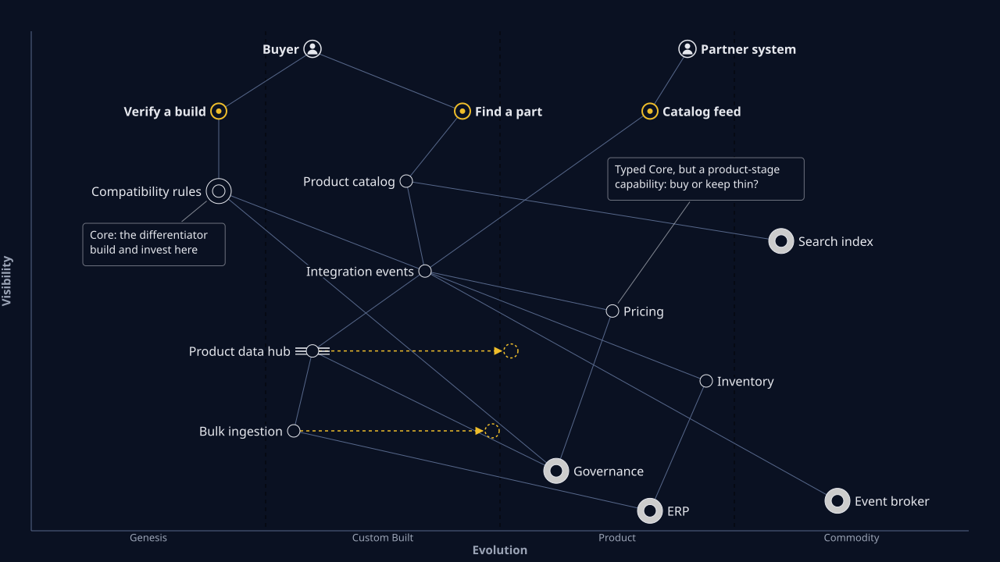

# Architecture for Flow: a worked example on Drone Web

This folder takes the design artifacts already in this repo (personas, job stories, Event Storming, the
read-side and write-side ADDR runs) and asks the strategic questions that come before code: which parts of
the drone shop are worth building, which should be bought, where the bounded contexts are, and which teams
should own them.

Drone Web is a fictional company. The case was anonymised from real interviews, and everything here uses only
what is in this repo. The example is illustrative: the placements and team shapes are judgements to argue
with, not findings.

## Credit

The approach is Susanne Kaiser's **Architecture for Flow**: combine Wardley Mapping, Domain-Driven Design and
Team Topologies to design a socio-technical system for a fast flow of change.

- Susanne Kaiser, *Architecture for Flow: Adaptive Systems with Domain-Driven Design, Wardley Mapping, and
  Team Topologies* (Addison-Wesley, 2025):
  <https://www.oreilly.com/library/view/architecture-for-flow/9780137392759/>
- Her free summary on InfoQ, *Adaptive, Socio-Technical Systems with Architecture for Flow: Wardley Maps, DDD,
  and Team Topologies* (July 2023):
  <https://www.infoq.com/articles/adaptive-socio-technical-systems-flow>
- The Architecture for Flow Canvas and her other articles: <https://susannekaiser.net/articles>

This example follows her sequence and borrows her vocabulary (streams of change, core / supporting / generic
subdomains placed by evolution stage, one owning team per bounded context, cognitive load, interaction modes).
The text, the map and the tables are our own. Her figures, tables and canvas layout are not reproduced; go to
the sources above for those.

The building blocks come from Simon Wardley (Wardley Mapping, CC BY-SA), Eric Evans (Domain-Driven Design) and
Matthew Skelton and Manuel Pais (*Team Topologies*).

## The four steps

| Step | File | Question it answers | Main inputs from this repo |
| --- | --- | --- | --- |
| 1. Map the landscape | [wardley-map.mmd](wardley-map.mmd), [wardley-map.svg](wardley-map.svg) | Who are the users, what do they need, and how evolved is each component that serves them? | Storefront personas and job stories, the Core/Supporting/Generic typing in the v2 boundary map |
| 2. Subdomains and bounded contexts | [subdomains-and-contexts.md](subdomains-and-contexts.md) | Which problem areas are core, and which contexts (read and write) own which language? How do they integrate? | Event Storming, storefront `boundaries.md`, v2 `boundary-map.md` and `boundaries.md`, both AsyncAPI files, `.ralph/agent/decisions.md` |
| 3. Team design | [team-design.md](team-design.md) | Which teams own which contexts, how do they interact, and do the API boundaries match the team boundaries? | Step 2, the JTBD pain points in `Specs/Case/JTBD/personas/cross-persona-summary.md` |
| 4. As-is to to-be | [as-is-to-be.md](as-is-to-be.md) | Where is the shop today, where should it go, and what are the first moves? | Steps 1 to 3 |

Each step feeds the next. The map's user needs become the candidate streams of change. The evolution stage of
each component, read together with its subdomain type, tells you whether to build, buy or outsource. The
bounded contexts become the units of ownership. The teams are then sized so that each one can own its contexts
without drowning, and the interaction modes say how they work together.

## Naming

The storefront run and the catalog management v2 run both number their job stories JS1 to JS6, for different
stories. This folder always prefixes them: "storefront JS4" (compatibility verification), "management JS6"
(compatibility rules management).

## How this was made

Produced with an AI agent (Claude Code) working only from this repo's artifacts and Susanne Kaiser's public
summary, and reviewed by Christian Johansen (GALAXITECH). The map source is Mermaid `wardley-beta`, rendered with
the GALAXITECH Wardley map renderer; the `%%` comments in the `.mmd` record the reasoning behind each link.
