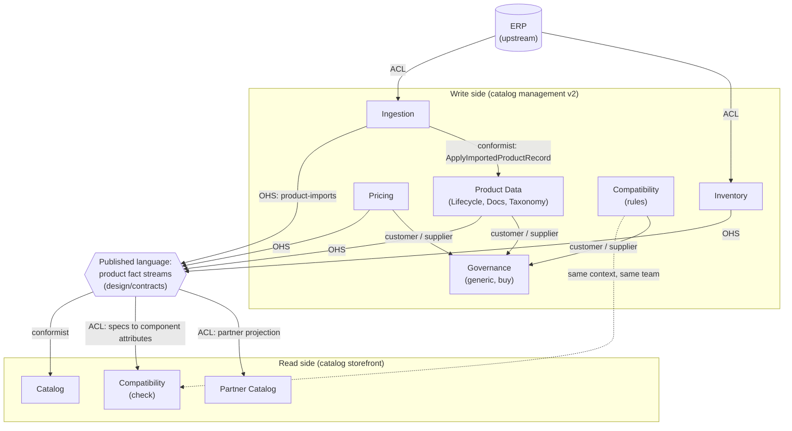

# Subdomains and bounded contexts

Step 2 of the [Architecture for Flow example](README.md). The [Wardley map](wardley-map.svg) shows the
landscape; this file partitions it into subdomains, places each one by evolution, and maps the bounded
contexts on both the read side and the write side.

## Subdomains

The write-side typing comes from the v2 boundary map
([`boundary-map.md`](../../catalog-management-v2/addr/align/boundary-map.md)). The read-side subdomains come
from the Event Storming swimlanes ([`event-storming.md`](../../catalog-storefront/addr/align/event-storming.md));
the repo does not type them, so the types shown for them are proposed here.

Kaiser's rule of thumb links the type to the evolution stage: core subdomains sit in genesis or custom built and
are built in house; supporting ones are custom built at low cost, or bought; generic ones are product or
commodity and are bought or outsourced. Where the repo's typing and the map disagree, the table says so.

| Subdomain | Side | Type | On the map | Evolution | Build, buy or outsource |
| --- | --- | --- | --- | --- | --- |
| Compatibility Verification (storefront JS4) | read | **Core** (proposed; the Event Storming calls the check "the key differentiator of the platform") | Verify a build | Genesis | Build, invest most |
| Compatibility Rules Management (management JS6) | write | Core | Compatibility rules | Genesis | Build, together with the check |
| Product Lifecycle Management (management JS1) | write | Supporting, with a **Core** spec model | Product data hub | Custom built, moving to product | Split: buy the hub (or build it thin) behind an ACL; build the spec model the compatibility rules read, which stays in Product Data |
| Pricing and Promotions Management (management JS3) | write | Core | Pricing | Product | **Tension**: typed Core, but price books with effective dates and volume tiers are a product-stage capability |
| Inventory and Availability Management (management JS4) | write | Core | Inventory | Product | **Tension**: typed Core, but stock and lead times are fed by the ERP |
| Technical Documentation Management (management JS2) | write | Supporting | (inside Product data hub) | Product | Buy or keep thin |
| Category and Faceting Management (management JS5) | write | Supporting | (inside Product data hub) | Custom built | Build thin; facets serve search |
| Bulk Ingestion | write | Supporting | Bulk ingestion | Custom built, moving to product | Build once as a shared capability |
| Catalog Governance Workflow | write | Generic | Governance | Product | Buy a workflow product |
| Product Discovery, Evaluation, Comparison, Browsing (storefront JS1, JS2, JS3, JS5) | read | Supporting (proposed) | Find a part, Product catalog | Custom built over a bought search index | Build the catalog projection, buy the search |
| Partner Catalog Access (storefront JS6) | read | Supporting (proposed) | Catalog feed | Product | Build a thin projection |

Two things stand out.

1. **Only compatibility is clearly core on the map.** Everything a buyer can get from any shop (search,
   prices, stock) sits in product. What a buyer cannot get elsewhere is the answer to "will these parts work
   together?" (voltage, current, physical fit, protocol, weight and thrust). That is where the investment
   belongs.
2. **Four Core types was a lot.** The v2 run typed Product Lifecycle, Pricing, Inventory and Compatibility Rules
   as Core. Product Lifecycle is now Supporting with a Core spec model (the product event contracts decision in [`.ralph/agent/decisions.md`](../../../.ralph/agent/decisions.md)): records and lifecycle states are
   what every shop has, while the spec model is what compatibility depends on. If Pricing and Inventory really differentiate the shop (for example through fleet volume tiers and
   guaranteed lead times for the Fleet Procurement Buyer), they belong further left on the map. If not, they
   are supporting. This is a decision for the business, not for this example.

## Bounded contexts

There are eleven API boundaries in the repo: three on the read side (storefront run, D-005) and eight on the
write side (v2 run, D-027, D-029). An API boundary is not always a bounded context. Where the same language
appears on both sides, the read API and the write API are two faces of one context.

| Bounded context | APIs (read / write) | Language | Owns |
| --- | --- | --- | --- |
| **Compatibility** | Compatibility API / Compatibility Rules API | component set, rule, mismatch, replacement, component group | CompatibilityCheck, CompatibilityRule |
| **Product Data** | (none) / Product Lifecycle API, Technical Documentation API, Category and Faceting API | product record, lifecycle state, document version, category, facet | Product, Document, Category |
| **Pricing** | (none) / Pricing and Promotions API | price book, tier, promotion, effective date | PriceBookEntry |
| **Inventory** | (none) / Inventory and Availability API | on hand, lead time, backorder, suspension | InventoryPosition |
| **Catalog** (discovery) | Catalog API / (none) | search, browse, filter, compare, review | read projections of products, categories, prices, availability |
| **Partner Catalog** | Partner Catalog API / (none) | feed, export, batch pricing, batch availability | CatalogFeed |
| **Governance** | (none) / Catalog Governance API | approval case, decision, publish gate | ApprovalCase |
| **Ingestion** | (none) / Bulk Ingestion API | import batch, validation, replay | ImportBatch |

Why Compatibility is one context with two APIs: the storefront run left an open hotspot ("who maintains the
rules?", Event Storming hotspot 1; OQ-004 in the decision log is still open), and the v2 run answered it with
the Compatibility Rules API. Both speak the same language about the same rules. Splitting them between owners
would put the rule model and the check that evaluates it on two sides of a team boundary.

Why Product Data groups three write APIs: product records, documents and categories are kept apart as APIs
(D-027) because their invariants differ, but they serve the same internal users (Product Lifecycle Manager,
Documentation Steward, Taxonomy Manager) and the same job: getting a product ready for the storefront. Whether
they stay one context or become three is a later call.

Product Data's role is identity and master data: what a product is (id, SKU, brand, attributes, specs) and
where it is in its life (draft, active, discontinued, replaced by). It sits on the management (write) side. It
is not an overview context: it does not gather price, stock, documents or categories. That overview lives with
each consumer, or later in a shared Product View once two consumers need the same rule.

## Context map

How to read the relationships:

- **Open host service and published language.** Each owning context publishes one stream of facts about its
  own part of a product, and the contracts in [`design/contracts/`](../../contracts/) are the published
  language (D-008). These are published events, translated from each context's internal events, which
  never leave the context. They carry the owner's current state, not identifiers only. No read side calls a write
  side synchronously (storefront `boundaries.md`, section C; v2 `boundaries.md`, section C).
- **Conformist.** The Catalog takes the published product, category, price and availability facts as they
  are; its job is to make them searchable, not to reinterpret them.
- **Anticorruption layer.** Partner Catalog translates catalog products into a simplified partner projection
  (stated in storefront `boundaries.md`, section C). The Compatibility check translates product specifications
  into the component attributes its rules evaluate (voltage range, current rating, mounting, protocol).
- **Customer / supplier with Governance.** Pricing, Compatibility Rules and Product Lifecycle submit high-risk
  changes for approval (`SubmitPricingChangeForApproval`, `SubmitRuleChangeForApproval`) and react to
  `governance.decision-recorded`. Approval happens before the owner publishes, so consumers only ever see
  approved facts.
- **Ingestion conforms to Product Data.** Bulk Ingestion dispatches `ApplyImportedProductRecord`, so it speaks
  Product Data's language; any translation from upstream files or the ERP happens inside Ingestion.
- **The ERP** is not designed anywhere in the repo. It appears in the JTBD interviews as the core ERP that
  product and stock data come from; treat it as an upstream system behind an anticorruption layer.

## A gap the context map exposes

The two AsyncAPI files do not fit together yet.

| | Storefront expects ([`integration-events.yaml`](../../catalog-storefront/addr/refine/integration-events.yaml)) | v2 publishes ([`integration-events.yaml`](../../catalog-management-v2/addr/refine/integration-events.yaml)) |
| --- | --- | --- |
| Channels | `catalog.product.created`, `.updated`, `.discontinued`, `.price-changed`, `.availability-changed`, `catalog.category.created`, `.updated` | `product.created`, `product.lifecycle-state-changed`, `price.group-repricing-requested`, `inventory.quantity-updated`, `category.facets-defined`, `document.version-published`, and four more |
| Payload | full product snapshot (name, specs, categories, pricing, availability) | identifiers only (`productId`, `repricingJobId`, ...) |
| Publisher | "Catalog API", which the storefront retrospective says is read-only | eight write boundaries |

With thin, identifier-only events and no synchronous cross-boundary calls, the read sides cannot build their
projections. Either the write side publishes facts (event-carried state), or something assembles the
`catalog.*` snapshot from the v2 events, and that something needs an owner. There is also no v2 event for a
single price change or a specification update, which the storefront's Compatibility and Partner contexts both
consume. The next file, [team-design.md](team-design.md), shows why one team never noticed.

The answer is now in [`design/contracts/`](../../contracts/): the write side publishes facts. Each owner
publishes a source-aligned stream (`product-records`, `product-specifications`, `effective-prices`,
`product-availabilities`, and others), each consumer builds its own join, and the partner feed is a join that
the Partner Catalog owns. For consumers these streams supersede the identifier-only v2 events.
